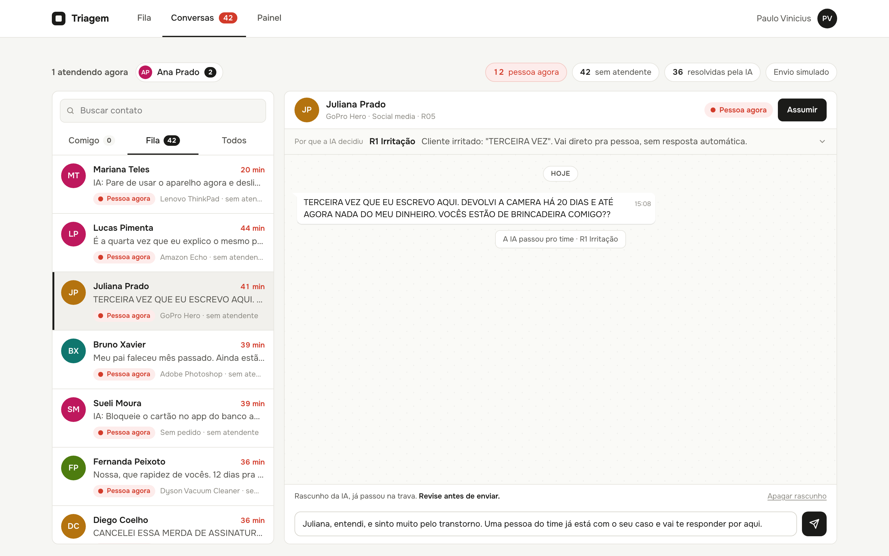

# Submissão · Vinicius Alves · Challenge 002

## Sobre mim

- **Nome:** Paulo Vinicius Vieira Alves
- **Challenge escolhido:** 002 · Redesign de Suporte

---

## Executive Summary

Quase todas as entregas deste desafio automatizaram a triagem: ler o ticket e mandar pra fila certa. Eu fui no risco que ninguém mediu, **a resposta ao cliente**, onde a IA promete o que não pode e o cliente chega no atendente já irritado. Construí um sistema em que **a IA lê, regras escritas decidem e uma trava confere tudo que sai**: ela nunca determina nada que comprometa a empresa. O diagnóstico mostra que o registro operacional não mede tempo nem satisfação, então a economia vira fórmula com premissas na mesa: **de 1,1 a 2,9 pessoas por ano**. O resultado mais importante veio do teste com tickets que o sistema nunca viu: **16 de 30, com 7 erros perigosos.** A causa foi o motor desobedecer o próprio princípio da política: na dúvida, ele respondia em vez de passar pra pessoa. Corrigido isso, os mesmos 30 deram **21 de 30 e 1 erro perigoso** (número que já não é cego). Daí a recomendação: na dúvida, pessoa. Um modelo lê o texto, as regras decidem, e nada vai pro ar antes do modo sombra.

---

## Como ler esta entrega

**Primeiro o caminho, depois a entrega.**

| # | Documento | O que tem |
|---|---|---|
| 00 | [Preparação do terreno](process-log/00-preparacao-do-terreno.md) | O que a vaga pede, por que o case 002, o que as 48 entregas fizeram e o que o avaliador cobra |
| 01 | [O que já se sabe](process-log/01-o-que-ja-se-sabe.md) | Tudo que já foi descoberto sobre os dados, com crédito e **conferido por script meu** |
| 02 | [Da tese ao sistema](process-log/02-da-tese-ao-sistema.md) | Da minha experiência até o sistema rodando e medido |
| 03 | [Diagnóstico](solution/03-diagnostico.md) | Onde trava, o que mexe na satisfação, e a conta do desperdício |
| 04 | [Proposta](solution/04-proposta.md) | O que automatizar e o que não, o fluxo, o protótipo, os resultados e o plano |
| 05 | [Política](solution/05-politica.md) | As 11 regras que decidem o que a IA faz |
| 06 | [Base de processos](solution/06-base-de-processos.md) | Os 26 processos que a IA consulta, ligados ao Código de Defesa do Consumidor |
| | [Decisões](process-log/decisoes.md) · [Erros da IA](process-log/erros-da-ia.md) | O que eu decidi, o que a IA sugeriu, e onde cada um errou |

---

## Solução

### Abordagem

1. **Não refazer o que já existia.** Levantei as 48 entregas públicas do case e os comentários do avaliador, e conferi cada achado nos dados com script próprio ([D01](process-log/decisoes.md)).
2. **Ir onde ninguém foi:** a resposta ao cliente, a partir da minha experiência operando atendimento com IA ([D02](process-log/decisoes.md)).
3. **Transformar experiência em teste:** 80 tickets difíceis, gabarito meu, e as minhas respostas viraram a [política](solution/05-politica.md).
4. **Processo escrito antes da IA:** uma [base de processos](solution/06-base-de-processos.md) ligada à lei.
5. **Construir, medir e medir de novo em tickets que o sistema nunca viu.**

### Resultados

| | |
|---|---|
| **Diagnóstico** | O Dataset 1 não mede tempo (sem data de abertura, 49,3% resolvem antes da 1ª resposta) nem satisfação (nada explica a nota). O sinal que se sustenta: 67% da fila parada |
| **Economia** | 1.932 a 5.094 horas por ano (R$ 48 mil a R$ 229 mil), com cada premissa declarada |
| **Divisão do trabalho** | Nos 110 tickets de teste: a IA resolve 48%, prepara o resumo de 33%, e 16% vão pra pessoa na hora |
| **Motor nos 80 tickets que escreveram as regras** | 80 de 80. Não prova nada |
| **Motor v1 nos 30 tickets novos (teste cego)** | **16 de 30, 7 erros perigosos.** Na dúvida, ele respondia sozinho |
| **Motor v2 nos mesmos 30 (já não é cego)** | **21 de 30, 1 erro perigoso.** Agora, na dúvida, vai pra pessoa |
| **Trava** | 24 de 24 frases certas |

O protótipo tem duas partes. O [motor](solution/motor/) lê, decide e redige. A [tela](solution/interface/) tem Fila, Conversas e Painel, com o rascunho da IA e a trava funcionando na caixa de resposta.



### Recomendações

1. **Registrar cinco campos por ticket antes de automatizar:** abertura, cada resposta, quem respondeu, o que foi prometido, se o cliente voltou.
2. **Escrever os processos reais** e passar pelo jurídico.
3. **Trocar o leitor por palavra-chave por um modelo que lê o texto.** As regras e a trava continuam iguais.
4. **Modo sombra até o erro perigoso ficar perto de zero.** Depois, liberar processo por processo.

### Limitações

- O leitor atual não está pronto pra produção. Mesmo na versão 2, ele ainda deixa passar 1 erro perigoso em 30 e manda pra pessoa casos que a IA podia resolver. E o 21 de 30 foi medido em tickets que eu já tinha visto.
- A política e os processos são de uma loja fictícia. Os pontos marcados [Validar] precisam do jurídico.
- Os 110 tickets fui eu que escrevi com a IA, porque o texto do Dataset 1 é falso. Todos usam só tipos, assuntos, produtos e canais que existem nele, e o script confere.
- O tempo de espera na tela é simulado e o envio também.

---

## Como rodar

Precisa só de Python 3.9 ou mais novo. **O motor, a tela, a trava e a conta não usam nenhuma biblioteca nem chave de API.**

```bash
cd submissions/vinicius-alves

python3 solution/motor/motor.py              # roda nos 80 tickets, mede e gera a tela
python3 solution/motor/testar_trava.py       # testa a trava com 24 frases
python3 solution/diagnostico/conta.py        # a conta do desperdício

python3 -m http.server 8766 --directory solution/interface
# abrir http://localhost:8766
```

**Pra refazer a verificação dos dados** (opcional, precisa baixar os datasets):

```bash
cd submissions/vinicius-alves/data
curl -L -o d1.zip https://www.kaggle.com/api/v1/datasets/download/suraj520/customer-support-ticket-dataset
curl -L -o d2.zip https://www.kaggle.com/api/v1/datasets/download/adisongoh/it-service-ticket-classification-dataset
unzip d1.zip -d d1 && unzip d2.zip -d d2 && cd ..

python3 -m venv .venv && .venv/bin/pip install -r requirements.txt
.venv/bin/python process-log/01-estado-da-arte/verificar_achados.py
```

---

## Process Log · Como usei IA

### Ferramentas usadas

| Ferramenta | Para que usei |
|---|---|
| **Claude Code** (Opus 5.5), no app desktop | Tudo: levantar as entregas públicas, conferir os dados, escrever tickets e regras, construir motor e tela, escrever os documentos. Eu falava por áudio, ele executava, eu decidia |
| **Navegador controlado pelo Claude** | Abrir os demos das outras entregas, testar a tela e tirar os prints |
| **Python** (scripts no repositório) | Cada número da entrega sai de um script que roda de novo |

### Workflow

Cada etapa tem um documento próprio, com uma tabela **"Quem fez o quê"** no final:

1. **[00 Preparação](process-log/00-preparacao-do-terreno.md):** eu trouxe a vaga e pedi pra estudar o que já foi entregue. A IA levantou os 208 PRs, separou os 48 do case 002, organizou os comentários do avaliador e abriu os demos.
2. **[01 O que já se sabe](process-log/01-o-que-ja-se-sabe.md):** eu decidi não redescobrir nada. A IA catalogou os achados e propôs conferir cada um nos dados.
3. **[02 Da tese ao sistema](process-log/02-da-tese-ao-sistema.md):** eu trouxe a tese e o gabarito. A IA transformou isso em teste, regras, processos, motor e tela, e mediu.

### Onde a IA errou e como corrigi

Dez erros dela e três meus, cada um com quem percebeu e o que mudou: **[erros-da-ia.md](process-log/erros-da-ia.md)**. Os que mais pesaram:
- **Tickets fora da estrutura do Dataset 1.** Eu percebi.
- **Primeira tela confusa pra um atendente.** Eu reprovei.
- **O 80 de 80 que não provava nada.** A própria IA avisou, e o teste com 30 tickets novos mostrou 7 erros perigosos. A correção veio de uma pergunta minha (E10): o motor desobedecia o próprio princípio.

### O que eu adicionei que a IA sozinha não faria

- **A tese.** A IA prometendo pra agradar, o processo mal documentado vindo antes da IA, e o cliente que não separa IA de pessoa. Isso vem de operar atendimento com IA, não de prompt.
- **O gabarito e as regras.** 33 respostas minhas viraram 11 regras. Cada resposta do gabarito diz se veio de mim, de uma regra minha aplicada pela IA ou de uma sugestão dela que eu aprovei.
- **O julgamento de produto.** Reprovei a primeira tela e trouxe a estrutura do inbox que eu mesmo construí.
- **A decisão de não refazer o que já existia**, pra gastar o tempo onde ninguém foi.

---

## Evidências

- [x] Screenshots do app ([process-log/screenshots/](process-log/screenshots/))
- [ ] Screen recording do workflow
- [ ] Chat exports
- [x] Git history (commits por etapa)
- [x] Outro: cada etapa documentada com "Quem fez o quê", um registro de [decisões](process-log/decisoes.md) e de [erros](process-log/erros-da-ia.md), e scripts que refazem todos os números

---

_Submissão enviada em: 22/10/2026_
