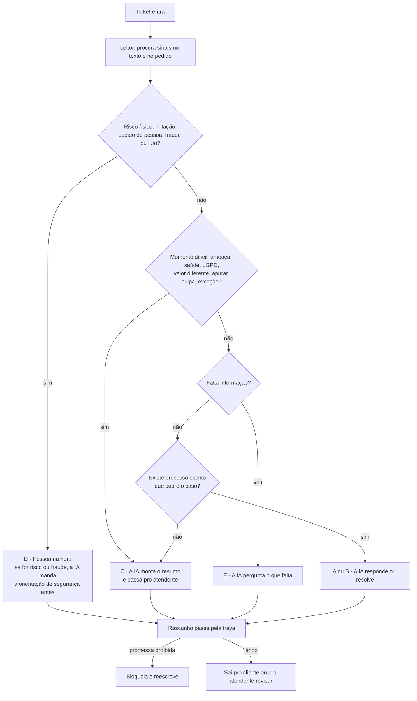

# 04 · Proposta de automação

Quase todo mundo que fez esse desafio automatizou a **triagem**: ler o ticket e mandar pra fila certa. É o lado fácil. O risco de verdade no suporte está na **resposta**: a IA falando com o cliente e prometendo o que não pode. "Seu reembolso cai até sexta", "foi erro nosso", "pode continuar usando". É isso que vira Procon, cliente bravo e atendente recebendo o cliente já irritado.

Não é teoria. A Air Canada foi condenada a pagar o reembolso que o chatbot dela inventou ([ABA, 2024](https://www.americanbar.org/groups/business_law/resources/business-law-today/2024-february/bc-tribunal-confirms-companies-remain-liable-information-provided-ai-chatbot/)). A Klarna trocou atendimento por IA pra cortar custo e voltou a contratar gente porque a qualidade caiu ([Entrepreneur, 2025](https://www.entrepreneur.com/business-news/%20klarna-ceo-reverses-course-by-hiring-more-humans-not-ai/491396)). E 64% dos clientes preferem que a empresa não use IA no atendimento, com o medo número um sendo não conseguir falar com uma pessoa ([Gartner, 2024](https://www.gartner.com/en/newsroom/press-releases/2024-07-09-gartner-survey-finds-64-percent-of-customers-would-prefer-that-companies-didnt-use-ai-for-customer-service)).

**A proposta:** a IA lê cada ticket, decide o próximo passo por regras escritas e redige a resposta. Uma trava confere tudo que sai. **A IA nunca determina nada que comprometa a empresa.** Ela informa, qualifica, resume e encaminha.

---

## O que automatizar e o que não

A regra completa está em [`05-politica.md`](05-politica.md). O resumo:

| A IA faz sozinha | A IA prepara e uma pessoa decide | Pessoa na hora |
|---|---|---|
| Informação que está escrita (ficha, garantia, prazo de arrependimento) | Caso ambíguo, com valor diferente ou que depende de exceção | Risco físico (bateria estufada, aparelho derretendo) |
| Arrependimento em até 7 dias (é lei, art. 49 do CDC) | Cliente num momento difícil | Cliente irritado ou que pediu uma pessoa |
| Cancelar pedido que ainda não saiu | Ameaça (Procon, Reclame Aqui) ou pedido por escrito | Fraude no cartão |
| Abrir estorno de cobrança duplicada com comprovante | Saúde, LGPD, suspeita de golpe | Luto |
| Recusar tentativa de manipular a IA | Alguém precisa apurar quem causou (o celular que chegou como tijolo) | |

**O princípio que segura tudo:** a IA só responde ou resolve sozinha quando existe um **processo escrito** que cobre o caso. São 26 processos em [`06-base-de-processos.md`](06-base-de-processos.md), cada um com o que a IA pode dizer, o que nunca pode dizer e a origem (lei, decisão minha ou regra da loja). Sem processo, vai pra pessoa. **Uma IA sem processo não sabe, e quando não sabe, inventa.**

---

## Como funciona na prática

**Onde a pessoa entra:** em todo D e C, com a conversa já organizada. O atendente abre o ticket e encontra:
- o porquê da decisão, com a regra e o trecho exato do cliente
- o resumo (produto, dias desde a compra, quantas vezes já voltou, o que quer)
- um rascunho que já passou pela trava

Ele revisa, edita e envia, ou escreve do zero. Se ele mesmo escrever uma promessa proibida, a trava avisa. Pra IA a trava bloqueia, pra pessoa ela avisa, porque aí a responsabilidade é de quem assinou.

---

## O protótipo

Duas peças, as duas sem dependência e sem chave de API:

- **O motor** ([`motor/`](motor/)), em Python: leitor (`sinais.py`), decisor com as regras (`regras.py`) e redator com a trava (`redacao.py`).
- **A tela** ([`interface/`](interface/)): Fila, Conversas e Painel, rodando nos tickets decididos pelo motor. A aba Conversas segue a estrutura de um inbox de atendimento real: quem está atendendo agora, lista com Comigo, Fila e Todos, e a conversa com o rascunho e a trava.

## Os dados que o protótipo usa

**O texto do Dataset 1 não serve pra testar uma IA de atendimento.** As 8.469 descrições têm `{product_purchased}` sem preencher, só 16 frases de abertura e resoluções que são frases aleatórias ("Deal step team east pressure."). Qualquer sistema "funcionando" em cima desse texto estaria funcionando em cima de nada.

Então escrevi **110 tickets em português, presos à estrutura do Dataset 1**. Cada um usa só os 5 tipos, os 16 assuntos, os 42 produtos e os 4 canais que existem no arquivo, e o script confere isso ([`teste/gerar_casos.py`](teste/gerar_casos.py)). O Dataset 1 tem a estrutura certa e o texto quebrado. Os testes escrevem o texto que ele deveria ter.

**O Dataset 2** (47.837 tickets reais de TI) entrou de dois jeitos:
1. **Como prova de que classificar texto real funciona:** um classificador simples acerta 86,6%, e com trava de 80% de certeza, 67% dos tickets vão sozinhos com 96,8% de acerto.
2. **Como prova de que ele não serve pra esta fila:** lendo os tickets de cliente, o mesmo modelo manda 90% pra Hardware. É TI interna, em inglês, outro mundo.

Por isso ele não está dentro do protótipo de atendimento ao cliente. Num service desk interno, ele seria o roteador por equipe, com a mesma lógica de trava de confiança.

---

## Os resultados, sem enfeite

| Teste | Resultado |
|---|---|
| **80 tickets usados pra escrever as regras** | 80 de 80 iguais ao gabarito. **Não prova nada:** as regras foram escritas olhando esses casos |
| **Versão 1 nos 30 tickets novos** (teste cego, escritos depois e com outras palavras) | **16 de 30. 7 erros perigosos** (a IA ficou com algo que era de pessoa) |
| **Versão 2 nos mesmos 30** (já não é cego) | **21 de 30. 1 erro perigoso** |
| **Trava, com 24 frases** (15 proibidas, 9 permitidas) | 24 de 24 |

**Por que a versão 1 quebrou.** Duas coisas somadas:
- **O leitor só conhece as palavras que eu coloquei.** "Bateria estufada" ele pega, "o carregador derreteu" não. "Não comprei nada" ele pega, "não fui eu que fiz" não.
- **O decisor desobedecia o princípio da política.** Quando nenhum sinal aparecia, ele respondia sozinho só por causa do tipo do ticket. Ter o tipo "problema técnico" não é ter um processo que cobre o caso.

Os dois erros mais graves foram o carregador derretendo e a compra que o cliente não fez. Os dois iam receber resposta automática.

**A versão 2 aplica o princípio:** a IA só responde ou resolve sozinha quando reconhece um processo escrito. Na dúvida, pessoa. Nada de palavra nova foi adicionada ao leitor. O resultado nos mesmos 30:
- **O erro perigoso que sobrou (N04):** "minha mãe está internada e preciso do dinheiro". O leitor não reconhece o momento difícil, e como a compra passou dos 7 dias, o processo de "fora do prazo" responde sozinho.
- **O carregador derretendo e a compra não reconhecida agora vão pra pessoa.** Mas vão como "resumo pronto", e não como "pessoa agora". Chegam ao atendente, só que sem a prioridade que mereciam.
- **Dois casos que a IA podia resolver foram pra pessoa** (notebook com defeito, cobrança duplicada). É o custo de jogar a dúvida pra pessoa.

**Leitura:** o princípio da política segura o risco mesmo com um leitor fraco. Mas **prioridade e momento difícil dependem de entender o texto**, e é aí que a palavra-chave não chega.

---

## O que isso muda: a IA lê, as regras decidem

A IA generativa é boa exatamente no que o leitor por palavra-chave não consegue: entender que "derreteu a ponta" é risco físico, mesmo sem a palavra "estufada". O desenho certo pra produção é:

1. **Um modelo lê o ticket** e devolve os sinais (risco, irritação, fraude, momento difícil, intenção).
2. **As regras escritas decidem.** São fixas e auditáveis, e a operação muda sem mexer no modelo.
3. **A trava confere** tudo que sai.

O modelo nunca decide e nunca promete. Se ele ler errado, o pior caso é mandar pra pessoa sem precisar, desde que a dúvida jogue pra pessoa.

## Plano de implantação

| Semana | O quê | Critério pra avançar |
|---|---|---|
| 1 a 4 | Registrar os cinco campos do [diagnóstico](03-diagnostico.md). Escrever os processos reais da empresa no lugar dos fictícios | Processos aprovados pelo jurídico |
| 5 a 8 | **Modo sombra:** a IA decide e redige, ninguém envia. Atendentes marcam onde ela errou | Erro perigoso perto de zero em pelo menos 500 tickets |
| 9 a 12 | Liberar só o A (informação) e o B dos processos mais claros (arrependimento, pedido não enviado) | Taxa de cliente que volta pelo mesmo assunto não sobe |
| Depois | Abrir mais processos, um por vez, com o mesmo critério | |

## Limitações

- **O leitor atual não está pronto pra produção.** No teste cego foram 7 erros perigosos em 30. Com o princípio aplicado, 1 em 30, mas medido em tickets já vistos, e com urgência perdida em 2 casos.
- **A política e os processos são de uma loja fictícia.** Os artigos do CDC são reais, mas os pontos marcados [Validar] precisam do jurídico.
- **O tempo de espera na tela é simulado**, porque o Dataset 1 não tem data de abertura.
- **A conta de economia é fórmula com premissas**, não medição.
- **O envio é simulado.** A integração real seria com o canal de atendimento da empresa.
